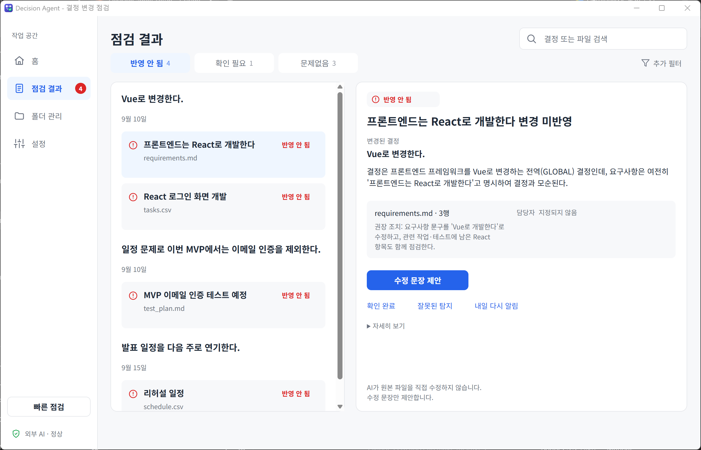
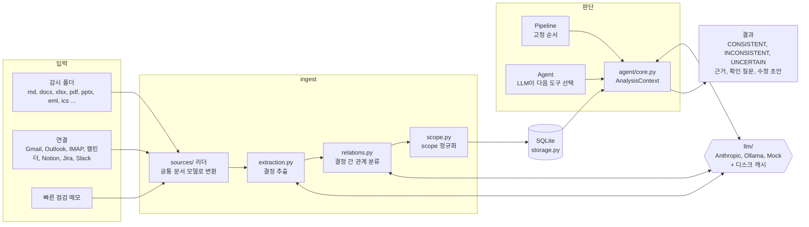
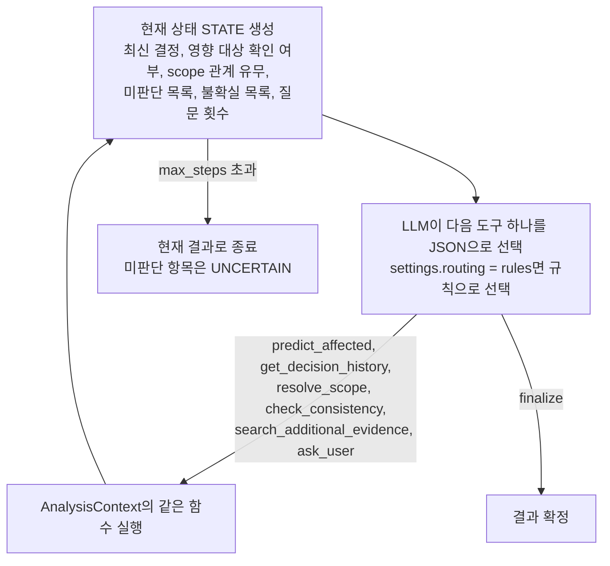

# Decision Agent: 의사결정 변경 전파 불일치 탐지 AI Agent

회의에서 결정이 바뀌었는데 요구사항, Task, 테스트 계획, 일정 문서에는 옛 내용이 남아 있는 경우를 찾아 주는 연구 프로토타입입니다. 결정이 적용되는 범위(release, module, user group, environment)를 함께 다루고, 근거가 부족하면 추측하지 않고 사용자에게 확인 질문을 합니다. 파일을 자동으로 고치지 않고, 불일치를 근거와 함께 보여 주는 데까지만 합니다.

2026년 학술제 출품작으로 개발했습니다(`docs/presentation/`).

<p align="center">
  
</p>

| 항목 | 내용 |
|---|---|
| 핵심 기능 | 결정 추출, 결정 간 관계 분류(교체·취소·범위 제한·연기), scope별 유효 결정 계산, 산출물 일치 판정, 확인 질문 |
| 판단 구조 | 같은 판단 함수(`agent/core.py`의 `AnalysisContext`)를 고정 순서 **Pipeline**과 도구 선택형 **Agent**가 공유 |
| 실행 형태 | Streamlit 데모 앱, Windows 상주 데스크톱 앱(FastAPI 로컬 서버 + WebView2 창 + 트레이), CLI |
| 모델 | Anthropic API, Ollama(로컬), 키가 없을 때의 규칙 기반 Mock 판정기 |
| 규모 | `src/` Python 약 22,800줄, 테스트 파일 64개 |
| 상태 | 0.2.0 연구 프로토타입. **실제 LLM에서의 탐지 품질은 아직 측정하지 않았습니다**(아래 [현재 상태](#현재-상태) 참고) |

## 목차

- [해결하려는 문제](#해결하려는-문제)
- [현재 상태](#현재-상태)
- [시스템 구조](#시스템-구조)
- [기술별 사용 위치](#기술별-사용-위치)
- [디렉터리](#디렉터리)
- [빠른 시작 (Windows 데스크톱 앱)](#빠른-시작-windows-데스크톱-앱)
- [개발 환경 설치와 실행](#개발-환경-설치와-실행)
- [판단 방식 상세](#판단-방식-상세)
- [테스트](#테스트)
- [평가 하네스 요약](#평가-하네스-요약)
- [데스크톱 상주 프로그램 요약](#데스크톱-상주-프로그램-요약)
- [개발 정보](#개발-정보)
- [한계](#한계)

## 해결하려는 문제

학생 팀이나 소규모 팀은 회의록, 요구사항 문서, 작업 표, 테스트 계획, 일정표를 따로 관리합니다. 회의에서 "MVP에서는 이메일 인증을 뺀다"처럼 결정이 바뀌어도 다른 문서에는 옛 내용이 그대로 남기 쉽습니다. 단순 키워드 검색으로는 두 가지를 구분하기 어렵습니다.

- **범위가 있는 결정**: MVP에서만 뺀 기능이 Production 문서에 남아 있는 것은 불일치가 아닙니다.
- **이전 결정을 가리키는 결정**: "기존 방식으로 돌아간다"는 결정 이력을 읽어야 무엇을 뜻하는지 알 수 있습니다.

이 프로젝트는 결정과 그 적용 범위를 구조화해 저장하고, 산출물마다 지금 유효한 결정을 계산한 뒤 LLM으로 일치 여부를 판정합니다. 판단할 근거가 부족하면 UNCERTAIN으로 남기거나 사용자에게 질문합니다.

## 현재 상태

| 구분 | 내용 |
|---|---|
| 구현됨 | 결정·관계 추출, scope 정규화와 resolver, Pipeline/Agent, 확인 질문, Streamlit 데모, 평가 하네스(합성 케이스, 기준선 B1~B3, 부트스트랩 구간), 데스크톱 앱(폴더 감시, 증분 재점검, LLM 응답 캐시, 메일·캘린더·Notion·Jira·Slack 읽기 연결, Gmail 보내기), PyInstaller/Inno Setup 패키징 |
| 저장소 기록상 확인된 것 | Windows 11에서 테스트, exe 빌드와 스모크 테스트, 조용한 설치·제거 등을 확인했다고 [docs/DESKTOP.md](docs/DESKTOP.md#이-단계의-한계)에 기록되어 있습니다 |
| 측정하지 않은 것 | 실제 LLM(Anthropic, Ollama)에서의 정밀도·재현율. `data/eval/human_written/`, `data/eval/real/`은 아직 비어 있어 독립 평가 데이터가 없습니다 |
| 실제 서비스에 붙여 보지 않은 것 | Google, Microsoft, Notion, Jira, Slack, IMAP 연결과 Ollama. 가짜 HTTP·IMAP 서버로 요청 형태와 오류 처리만 시험했습니다 |
| 작성만 하고 실행하지 않은 것 | `.github/workflows/build-windows.yml` (GitHub Actions) |

`docs/PROGRESS.md`의 속도·호출 수 측정값은 정답표를 읽는 시뮬레이션 모델로 잰 값이며 실제 모델의 정확도를 뜻하지 않습니다.

## 시스템 구조



Agent의 한 단계는 다음과 같습니다(`agent/agent.py`의 `run_agent`).



## 기술별 사용 위치

| 기술 | 사용 위치 | 역할 |
|---|---|---|
| Pydantic | `models.py`, `agent/agent.py` | 결정·관계·판정 결과 스키마, LLM JSON 응답 검증(`ToolChoice` 등) |
| scikit-learn | `impact.py`, `retrieval.py` | 문자 n-gram(2~4) TF-IDF로 영향 후보 산출물 검색 |
| Anthropic SDK | `llm/anthropic_provider.py` | 추출, 관계 분류, 판정, Agent 도구 선택 호출 |
| Ollama HTTP | `llm/ollama_provider.py`, `desktop/embeddings.py` | 로컬 모델 판정, 선택적 임베딩 보강 |
| SQLite | `storage.py`, `desktop/state.py`, `desktop/maildb.py` | 결정·관계 저장, 앱 상태, 메일 색인, 판정 재사용 |
| Streamlit | `app/streamlit_app.py` | 데모 시나리오를 Agent와 Pipeline으로 비교 실행 |
| FastAPI, uvicorn | `desktop/webapp.py` | `127.0.0.1` 전용 로컬 웹 API와 화면 |
| watchdog | `desktop/watcher.py` | 감시 폴더 변경 이벤트 수집과 디바운스 |
| pywebview, pystray, winotify | `desktop/shell.py`, `desktop/tray.py`, `desktop/notify.py` | 독립 창(WebView2), 트레이, 토스트 알림 |
| keyring | `desktop/secrets.py` | API 키와 연결 토큰을 OS 자격 증명 저장소에만 저장 |
| python-docx, openpyxl, pypdf, python-pptx, BeautifulSoup | `sources/readers_office.py`, `sources/readers_text.py` | 문서 형식별 텍스트·표 추출 |
| PyInstaller, Inno Setup | `packaging/` | Windows exe와 설치 파일 생성 |
| pytest, ruff | `tests/`, `pyproject.toml` | 네트워크 없는 단위·통합 테스트, 린트 |

## 디렉터리

| 경로 | 내용 |
|---|---|
| `src/decision_agent/` | 판단 엔진: `extraction.py`, `relations.py`, `scope.py`, `resolver.py`, `consistency.py`, `clarification.py`, `uncertainty.py` |
| `src/decision_agent/agent/` | `core.py`(공유 판단 로직), `pipeline.py`, `agent.py`, `tools.py` |
| `src/decision_agent/llm/` | Provider 추상화, Anthropic·Ollama·Mock, 캐시, 묶음 호출 |
| `src/decision_agent/sources/`, `parsing/` | 파일 형식별 리더와 문서 구역 분류 |
| `src/decision_agent/connectors/` | 메일·캘린더·협업 도구 읽기 연결, OAuth(PKCE) |
| `src/decision_agent/desktop/` | 상주 앱: 엔진, 감시, 로컬 웹 서버, 트레이, CLI, 설정 |
| `src/decision_agent/eval/` | 평가 하네스: 케이스 생성기, 기준선, 지표, 리포트 |
| `app/streamlit_app.py` | 1단계 데모 앱 |
| `data/demo/`, `samples/` | 가상 데모 데이터(메일 주소는 모두 `example.com`) |
| `data/eval/` | 평가 케이스(합성 62개, 어시스턴트 작성 10개, 사람 작성·실제 문서 폴더는 비어 있음) |
| `tests/` | pytest 테스트 |
| `tools/`, `packaging/` | 시연·벤치마크 스크립트, 빌드 스크립트 |
| `docs/` | [DESKTOP.md](docs/DESKTOP.md)(데스크톱 앱 상세), [EVALUATION.md](docs/EVALUATION.md)(평가 하네스), `PROGRESS.md`(작업 기록), `DEMO_SHEET.md`(시연 대본), `design/`(화면 시안), `screenshots/`, `presentation/`, `qa/` |


## 빠른 시작 (Windows 데스크톱 앱)

1. 설치와 업데이트: Python 3.11 이상을 설치한 뒤, 저장소 폴더에서 PowerShell로 실행합니다.

   ```powershell
   powershell -ExecutionPolicy Bypass -File .\tools\update_windows.ps1
   ```

   실행 중인 프로그램을 끄고, 예전 설치본을 지우고, 지금 코드를 `%LOCALAPPDATA%\Programs\DecisionAgent`에 설치한 뒤 바탕화면과 시작 메뉴에 바로 가기(콘솔 창 없음)를 만듭니다. 마지막에 버전과 커밋을 출력하고 프로그램을 시작합니다. 관리자 권한이 필요 없고 두 번 실행해도 됩니다. 설정, 결과, 메일 색인, 로그가 있는 `%APPDATA%\DecisionAgent`와 자격 증명 관리자의 키와 로그인은 그대로 둡니다.

2. 모델: 설정 > 점검 > 확인 방식에서 "외부 AI"를 고르고 API 키와 모델 이름을 입력한 뒤 "연결 테스트"를 누릅니다. 외부 AI는 외부 전송에 동의해야 쓰입니다. 키는 Windows 자격 증명 관리자에만 저장됩니다. 키가 없으면 데모 확인 방식으로 돌고, 이때는 "검사 완료"가 아니라 "데모로만 점검"으로 표시됩니다.

3. 폴더: 홈의 "폴더 추가"로 회의록과 산출물이 있는 폴더를 고릅니다. 폴더는 읽기만 하고, 앱 데이터는 폴더 안에 만들지 않습니다.

4. Gmail: 설정 > 연결에서 Gmail 연결 마법사를 따라 Google Cloud 콘솔에서 만든 데스크톱 앱 OAuth 클라이언트 ID를 넣고 로그인합니다. 처음 로그인은 읽기 권한만 요청합니다. 그다음 메일 소스(라벨, 보낸 사람, 제목 키워드)를 만듭니다.

5. 메일 보내기(선택): Gmail 연결 카드의 "메일 보내기"를 켜면 Google 동의 화면이 한 번 더 열리고 보내기 권한(gmail.send)만 추가로 요청합니다. 메일은 "메일 쓰기", "답장", "전체 답장", "담당자에게 알리기"에서 사용자가 받는 사람을 확인하고 보내기를 눌렀을 때만 나가며, 5초 안에 취소할 수 있습니다. 한 번에 받는 사람 10명, 시간당 20통, 하루 100통까지입니다. Outlook과 IMAP 연결은 읽기 전용입니다.

6. 성능 모드: 설정 > 고급 > 성능에서 고릅니다. "절약"은 AI 요청 4개와 결정 주제 2개씩, "보통"(기본)은 16개와 8개씩, "최대"는 32개와 16개씩 동시에 처리합니다. 같은 카드에서 마지막 점검의 단계별 시간, AI 요청 수, 재사용한 줄 수를 보고, "저장된 결과 정리"와 "다시 인덱싱"을 할 수 있습니다.

문제가 있으면 `python -m decision_agent.desktop selftest`(설치 점검, JSON 출력, 문제가 있으면 종료 코드 1)와 `python -m decision_agent.desktop state --json`(저장된 상태를 읽기 전용으로 출력)을 실행하거나, 설정 > 고급 > 정보의 "진단 정보 복사"를 눌러 붙여 넣어 주세요. 셋 다 비밀 값과 문서 내용을 담지 않습니다.

## 개발 환경 설치와 실행

```bash
python -m venv .venv
. .venv/bin/activate        # Windows: .venv\Scripts\activate
pip install -e ".[dev,desktop]"   # 데스크톱 모듈 테스트까지 실행하려면 desktop 포함
pytest
streamlit run app/streamlit_app.py
```

`streamlit run`은 데모 시나리오 화면(`app/streamlit_app.py`)을 엽니다. API 키가 없으면 규칙 기반 MockProvider로 실행되고 화면에 "데모 모드"가 표시됩니다.

실제 LLM을 쓰려면 두 환경변수를 모두 설정합니다.

```bash
export ANTHROPIC_API_KEY=...
export DECISION_AGENT_MODEL=...      # 사용할 모델 이름
```

| 환경변수 | 설명 |
|---|---|
| `ANTHROPIC_API_KEY` | Anthropic API 키 |
| `DECISION_AGENT_MODEL` | 모델 이름 (코드에 하드코딩하지 않음) |
| `DECISION_AGENT_LOG_CONTENT=1` | 문서 내용을 로그에 남길 때만 설정 |

데스크톱 앱은 `pip install -e ".[desktop]"` 뒤 `decision-agent run`으로 실행합니다. 명령 목록, 읽는 파일 형식, 연결 설정, 안전 원칙, exe 빌드는 [docs/DESKTOP.md](docs/DESKTOP.md)에 있습니다. 데스크톱 앱 상태는 `%APPDATA%\DecisionAgent`(Windows) 또는 XDG 경로에 저장되며 `DECISION_AGENT_HOME`으로 바꿀 수 있습니다.

## 판단 방식 상세

### Agent와 Pipeline

```
회의록, 산출물  ->  ingest (추출, 관계 분류, scope 정규화)   [Agent와 Pipeline이 공유]
                      |
                      +-- Pipeline : 고정 순서로 실행
                      +-- Agent    : 상태를 보고 다음 도구를 선택
```

핵심 판단 로직은 `agent/core.py`의 `AnalysisContext` 한 곳에 있고, Agent와 Pipeline이 같은 함수를 호출합니다. 둘의 차이는 판단 알고리즘이 아니라 어떤 정보를 언제 더 찾고, 언제 질문하고, 언제 끝낼지를 정하는 방식뿐입니다.

#### Pipeline (대조군)

`affected_prediction -> scope_resolution -> consistency_detection -> (clarification) -> finalize`

항상 같은 순서입니다. 결정 이력을 따로 읽지 않습니다. `Pipeline+질문`은 마지막에 같은 질문 모듈을 호출합니다.

#### Agent

매 단계 LLM이 현재 상태(STATE)를 읽고 다음 도구 하나를 JSON으로 고릅니다. 상태에는 최신 결정문, 영향 대상 확인 여부, 범위 지정 관계 존재 여부, 미판단 목록, 불확실 목록, 질문 횟수가 들어갑니다.

| 도구 | 하는 일 |
|---|---|
| `predict_affected` | 결정 이력과 TF-IDF 후보로 영향 대상을 찾는다 |
| `get_decision_history` | 결정 이력을 읽고 이후 판단의 근거로 쓴다 |
| `resolve_scope` | 산출물별로 유효한 결정을 확인한다 |
| `check_consistency` | 산출물을 판단한다 (반복 샘플링으로 불확실성 추정) |
| `search_additional_evidence` | 모인 사용자 답변을 조회한다 |
| `ask_user` | 기대 이득이 가장 큰 질문 하나를 하고, 불확실했던 항목만 재판단한다 |
| `finalize` | 현재 결과로 끝낸다 |

`max_steps`를 넘으면 현재 결과로 강제 종료하고, 판단하지 못한 항목은 UNCERTAIN으로 보고합니다.

### Scope 모델

`GLOBAL`, `SCOPED`, `UNKNOWN`을 구분합니다. `UNKNOWN`은 `GLOBAL`과 같지 않습니다.

- `SCOPE_RESTRICT`, 범위가 있는 `SUPERSEDE`, `CANCEL`은 기존 결정의 전역 상태를 바꾸지 않습니다. 범위별 효과는 relations 테이블과 resolver가 계산합니다.
- `POSTPONE`은 기존 결정을 ACTIVE로 두고 resolver의 `effective_due_date`로 반영합니다.
- 산출물의 scope가 UNKNOWN이면, 그 topic에 범위가 지정된 결정이 있을 때만 불확실로 처리합니다. 모든 결정이 GLOBAL이면 어떤 scope여도 결과가 같으므로 판단을 진행합니다.

### 확인 질문

불확실한 항목이 있으면 질문 후보를 최대 3개 만들고, 가정 답변("예", "아니오", "일부만")별 기대 이득을 평균해 가장 큰 후보를 고릅니다. 최대 기대 이득이 `min_gain` 미만이면 질문하지 않고 UNCERTAIN으로 보고합니다. 답변은 근거로 저장되어 해당 항목의 판단 프롬프트에 들어가며, 불확실했던 항목만 다시 판단합니다. 질문은 한 번에 하나씩, 최대 `max_questions`회입니다. 결정 범위가 불확실해 판단이 막힌 항목도 사용자가 답하면 답변과 resolver 메모(`RESOLVER_NOTE`)를 함께 LLM에 넘겨 판단합니다. 답이 없으면 계속 UNCERTAIN입니다.

### 불확실성

`ConsistencyResult.confidence`는 보정된 확률이 아닙니다. 같은 판단을 N회 샘플링했을 때 다수 라벨과 일치한 비율(self-consistency)이며, 결정이나 scope를 확정하지 못해 UNCERTAIN이 된 경우에는 0.0입니다. 근거 충분도는 유효한 결정을 확정할 수 있는지로만 판단합니다.

### 데모 시나리오 (data/demo)

| 시나리오 | topic | 기대 동작 |
|---|---|---|
| 1. 범위 제한 | email_auth | MVP 산출물 INCONSISTENT, Production 산출물 CONSISTENT. 9/01 결정은 ACTIVE 유지. Agent는 `resolve_scope`를 사용 |
| 2. 영향 범위 불명확 | presentation_schedule | 세 일정 UNCERTAIN, 질문 1회, 답변 후 발표 CONSISTENT, 리허설과 자료 제출 INCONSISTENT |
| 3. 이전 결정 참조 | frontend_framework (기준일 최신) | 결정문 "기존 방식으로 돌아간다". Agent는 이력을 읽어 해소, Pipeline은 UNCERTAIN |
| 4. 새 Task 사전 경고 | 새 Task 탭 | "MVP 이메일 인증 UI 개발"은 경고, "Production 이메일 인증 설계"는 경고 없음, 애매하면 참고 |
| 5. 명확한 교체 | frontend_framework (기준일 2026-09-15) | React에서 Vue로 교체. 이력 조회와 질문 없이 조기 종료 |

앱에서 시나리오 3과 5는 같은 topic이며 "기준일"로 구분합니다.

## 테스트

```bash
pytest
```

테스트는 네트워크 없이 동작하도록 작성되어 있습니다. MockProvider 기반 테스트는 코드 배선과 규칙 확인용입니다. Agent가 실제 LLM에서 상황에 따라 다른 경로를 고르는지는 이 테스트로 증명되지 않으며, 평가 하네스의 경로 분석으로 실제 Provider에서 측정해야 합니다.

| 확인 일자 | 환경 | 명령 | 결과 |
|---|---|---|---|
| 2026-11-05 | Windows 11, Python 3.14.7, 새 venv | `pip install -e ".[dev,desktop]"` 후 `pytest` | 767 passed, 2 skipped (API 키 없음). `.[dev]`만 설치한 상태는 확인하지 않았습니다 |
| 2026-11-05 | 같은 환경 | `ruff check .` (ruff 0.17.3) | 2건: `tools/demo_preflight.py`, `tools/demo_reset.py`의 PLW1510(`subprocess.run`에 `check` 미지정) |
| 2026-11-05 | 같은 환경 | `PYTHONPATH=src python -m decision_agent.eval.runner --sources synthetic --methods all --oracle-stage none --repeats 1 --limit 3 --out <폴더>` | Mock으로 `report.md`, `rows.csv`, 그래프 생성 확인(배선 확인용, 성능 근거 아님) |
| 2026-11-05 | 같은 환경 | `python -m decision_agent.desktop selftest --no-model` | `"ok": true` |

`pyproject.toml`은 Python 3.11 이상을 요구합니다. 위 표는 3.14에서 확인한 결과이며 3.11~3.13에서는 이번에 다시 실행하지 않았습니다.

## 평가 하네스 요약

`src/decision_agent/eval/`과 `data/eval/`에 평가 코드와 케이스가 있습니다. 검색만 하는 기준선(B1 TF-IDF), 검색 후 LLM 1회 판정(B2), 전체 결정 로그를 넣는 긴 문맥 판정(B3)과 Pipeline, Pipeline+질문, Agent, Agent+질문, scope 제거 실험을 같은 케이스로 비교하도록 구성했습니다. 지표는 INCONSISTENT를 양성으로 한 정밀도·재현율·F1(케이스 단위 부트스트랩 95% 구간), UNCERTAIN 비율, scope 함정 오탐률, 질문 수, ECE, LLM 호출 수 등입니다.

현재 저장소의 케이스는 생성기로 만든 합성 62개와 AI 어시스턴트가 작성한 10개뿐이며, 둘 다 시스템과 같은 쪽에서 설계한 것이라 독립 증거가 아닙니다. 실제 모델 결과는 아직 없습니다. 실행 방법과 해석 시 주의점은 [docs/EVALUATION.md](docs/EVALUATION.md)에 있습니다.

## 데스크톱 상주 프로그램 요약

3단계에서는 Streamlit 대신 트레이 상주 앱을 만들었습니다. 등록한 폴더를 읽기 전용으로 감시하다가 문서가 바뀌면 30초 동안 변경을 모아 바뀐 파일만 다시 읽고, 결정·관계·후보 산출물의 지문이 바뀐 topic만 다시 점검합니다. 같은 입력의 LLM 응답(온도 0)은 디스크 캐시에서 가져오므로 바뀌지 않은 문서는 새 호출이 없습니다. 새로 INCONSISTENT가 된 항목만 알림을 보냅니다.

외부 전송은 기본 꺼짐이며, 전송 스위치·API 키·모델 이름이 모두 있어야 문서가 외부 LLM으로 나갑니다. 웹 화면은 `127.0.0.1`에서만 열리고 Host 헤더 검사, API 토큰 헤더, CSP nonce를 적용합니다. 상세 내용은 [docs/DESKTOP.md](docs/DESKTOP.md)에 있습니다.

## 개발 정보

| 항목 | 내용 |
|---|---|
| 개발 기간 | 커밋 기록 기준 2026-10-24 ~ 2026-11-04 (첫 커밋은 0.2.0 기준선이므로 이전 작업 기간은 커밋에 나타나지 않습니다) |
| 작성자 | 이은정 (저장소의 모든 커밋 작성자) |
| 성격 | 2026년 학술제 출품 연구 프로토타입 |
| 라이선스 | 지정되지 않음 |

## 한계

- 데모 데이터는 합성이며 실제 조직의 문서에 대한 일반화를 보장하지 않습니다.
- LLM은 비결정적이며 같은 입력에도 결과가 달라질 수 있습니다.
- 영향 후보는 문자 n-gram TF-IDF로 뽑으므로 어휘가 크게 다른 표현(예: "이메일 인증"과 "OTP")은 놓칠 수 있습니다. 유사도 0인 후보는 버립니다.
- scope 추출은 별칭 사전(`scope_aliases.json`)과 LLM 추출 정확도에 의존합니다.
- MockProvider의 결과는 성능 근거가 아닙니다. 발표용 수치는 실제 LLM으로 다시 측정해야 합니다.
- 외부 LLM API로 문서를 보내면 기밀 문제가 생깁니다. 실제 팀 문서는 민감 정보를 가린 뒤 쓰거나 로컬 모델을 사용하세요.
- 이 도구는 자동 수정을 하지 않고, 조치는 사람이 읽는 한 문장으로만 제안합니다.
